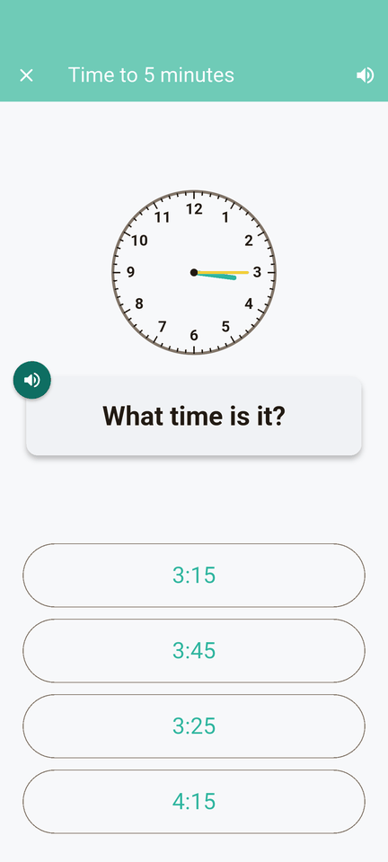
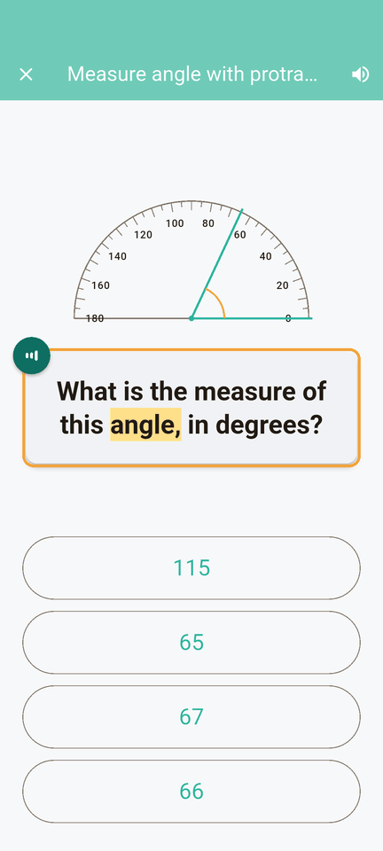
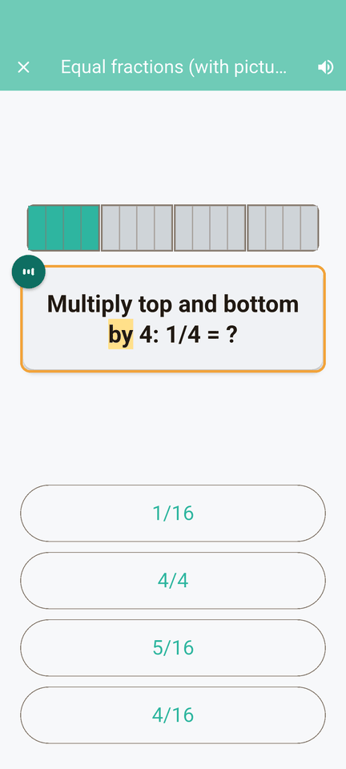
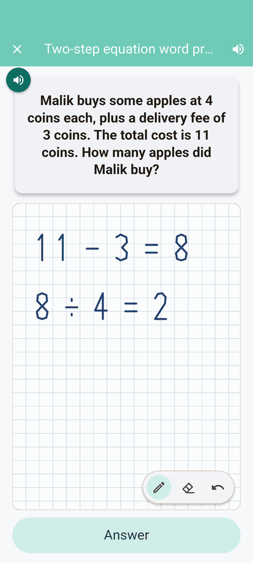
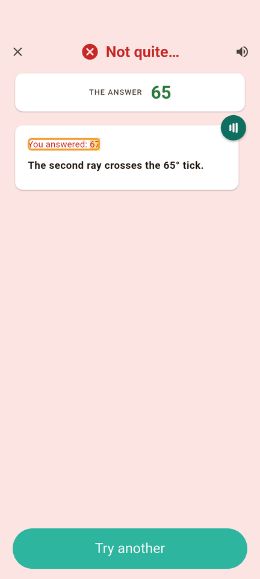

<p align="center"></p>

<p align="center"><b>Build a whole city by solving math problems.</b><br>
Available on iPad, iPhone and Android for kids aged 6 to 14.</p>

<p align="center">
  <a href="https://github.com/quarup/math_city/actions/workflows/ci.yml"></a>
  <a href="LICENSE"></a>
  <a href="#licensing"></a>
</p>

<p align="center">
  
  
</p>

In Math City, every math problem a kid solves builds their city: a first
little house, then shops, schools, parks and streets that light up at
night. Townspeople send letters asking for what they need next, and it's up
to you to build it.

<p align="center">
  
  
  
  
  
</p>

The questions adapt to each child. There are over 350 skills from
kindergarten to grade 8, including counting, addition and subtraction, times
tables, fractions, decimals, measurement, geometry and early algebra. New
topics appear as earlier ones are mastered. Questions can be read aloud, and
longer ones come with a scratch pad for working out.

Several kids can share one device, each with their own player, avatar and
city. The game works offline, has no ads or purchases, and collects no data.
Everything stays on the device ([privacy policy](PRIVACY.md)).

<p align="center"><sub>Ages 6 to 14 · iPad or iPhone · Free, no ads · Works offline · Collects no data · Several kids per device</sub></p>

## Status

The website for parents is **[quarup.github.io/math_city](https://quarup.github.io/math_city/)**.

Math City is in beta. Friends and family test it through TestFlight on iOS;
the Android build runs on the emulator and on devices. It is not on the App
Store or Google Play yet. Bugs and ideas go in
[GitHub issues](https://github.com/quarup/math_city/issues), or by email to
quarup.mc@gmail.com.

## Build it yourself

You need the [Flutter SDK](https://docs.flutter.dev/get-started/install)
(stable channel), plus Xcode for iOS or Android Studio for Android.

```sh
git clone https://github.com/quarup/math_city.git
cd math_city
flutter pub get
flutter run            # on a connected device or a running simulator/emulator
```

Debug builds show a *Debug* link on the home screen that opens any of the
questions directly. Release builds don't.

## How it works

- **Flutter + Flame.** One codebase for iOS and Android; the city is a Flame
  canvas, everything else is Flutter widgets. Riverpod 3 for state, Drift
  (SQLite) for local persistence.
- **Questions are generated, not authored.** 354 parameterized generators
  in `lib/domain/questions/` produce endless variations, with procedural
  diagrams (clocks, protractors, number lines, fraction bars, grids,
  graphs) in `lib/presentation/diagrams/`. A small bundled dataset in
  `assets/data/` backs the word problems. There are no runtime LLM calls.
- **A curriculum graph decides what's next.** 360 sub-concepts across 12
  categories form a prerequisite graph ([curriculum.md](curriculum.md)).
  A player starts at their grade; mastering a concept unlocks the ones that
  build on it, and outgrown ones retire from the wheel.
- **The city is the reward loop.** Placing a building starts a construction
  site; every correct answer earns coins that pay it down; buildings unlock more buildings,
  and the townspeople's letters nudge the player toward what the city needs
  ([city_builder.md](city_builder.md)).

### Code layout

Four layers, top to bottom:

1. **Presentation** (`lib/presentation/`): Flutter widgets
2. **Game** (`lib/game/`): Flame components
3. **Domain** (`lib/domain/`): pure Dart rules, no Flutter or Flame imports.
   This is the testable core; most of the 1,300+ tests live against it.
4. **Data** (`lib/data/`): Drift schema and repositories

### Documentation

| doc | what it's for |
|---|---|
| [prd.md](prd.md) | product scope. Read before proposing a feature. |
| [plan.md](plan.md) | execution plan. **The Status block at the top is the source of truth for what's in scope right now.** |
| [curriculum.md](curriculum.md) | the K–8 sub-concept catalog, prerequisite graph and diagram needs. Read before touching questions. |
| [city_builder.md](city_builder.md) | the city: buildings, construction, letters, ground and sky. |
| [CLAUDE.md](CLAUDE.md) | conventions and architecture, for humans and AI agents alike. |

### Auditing question quality

Because the questions are generated rather than authored, the way to find
content bugs is to *look at them*. The `/ux-sweep` skill does that at scale:
it plays a real question for each concept on the Android emulator,
screenshots it in both the multiple-choice and keypad interfaces, answers it
right and then wrong (capturing the explanation), and writes a reviewed
report to `ux_reports/<date>-<scope>-<band>/report.md`.

```
/ux-sweep 3.5           # one curriculum section
/ux-sweep fractions     # a category
/ux-sweep all           # the whole catalogue, about 27 minutes
```

It's driven by a `kDebugMode`-only HTTP control port in the app
([lib/services/debug_harness.dart](lib/services/debug_harness.dart)), so it
never navigates by tapping at screenshot coordinates and never has to guess
a question's answer. Flutter render errors are captured as data. The report
builder validates its own coverage and fails loudly if any concept went
unprobed or unreviewed. Details:
[.claude/skills/ux-sweep/SKILL.md](.claude/skills/ux-sweep/SKILL.md).

## Licensing

**Code: Apache License 2.0.** The source code in this repository is
licensed under the [Apache License, Version 2.0](LICENSE): `lib/`,
`test/`, `tools/`, the `android/` and `ios/` projects, and the build
configuration.

**Original artwork: Creative Commons Attribution 4.0.** The game's own
art is licensed under [CC BY 4.0](https://creativecommons.org/licenses/by/4.0/):
reuse it, change it, even sell it, as long as you credit
"Math City (github.com/quarup/math_city)". That covers:

- the building and vehicle sprites (`assets/buildings/`, `assets/vehicles/`)
  and their unprocessed source images (`tools/sprite_pipeline/raw/`,
  `tools/sprite_pipeline/raw_sheets/`);
- the home-screen art and the intro's tile art (`assets/images/`), except
  the items reserved below;
- screenshots of that art (for example under `ux_reports/` and
  `docs/readme/`).

**Name and icon: reserved.** "Math City", the wordmark
(`assets/images/math_city_wordmark.png`) and the app icon are © 2026 Quarup Barreirinhas,
all rights reserved, and are not covered by either licence. The icon includes
the house tile it is drawn from (`assets/images/tiles/house.svg`), the
launcher icons and launch images under `android/app/src/main/res/` and
`ios/Runner/Assets.xcassets/`, and the icon drawing in
[tools/app_icon/build_icon.py](tools/app_icon/build_icon.py). As section 6
of the Apache license and section 2(b)(2) of CC BY 4.0 both say, neither
licence grants trademark rights. A fork or a game reusing the art must use
its own name and icon.

**Add-on packs.** Any paid art packs are separate, all rights reserved,
and are not published in this repository.

**Third-party content keeps its own licence.** The bundled question
datasets and the avatar art (DiceBear's *Adventurer* style by Lisa
Wischofsky, CC BY 4.0) are listed with their licences and required credits in
[LICENSES_THIRD_PARTY.md](LICENSES_THIRD_PARTY.md). Every third-party asset
or dataset must be CC0, CC-BY, MIT, Apache 2.0 or equivalent; `CC-BY-NC` and
`CC-BY-NC-SA` are excluded because app-store distribution carries
non-zero commercial-use risk.
