# UX sweep — 2026-10-19-answer-blanks-both

- Input mode: **both**
- Concepts probed: **7** (7 reviewed)
- ✅ 7 clean · 🎨 0 could improve · 🐞 0 bug

Each question screenshot is the exact screen the player sees. The wrong-answer screenshot is that same question, replayed from its seed and answered with a distractor.

**One wrong-answer screenshot covers both input modes.** The band never reaches the result screen — it renders from the question, the submitted answer and the outcome, and in debug mode bricks are always 0 and the unlock event null. Same seed → same question → same distractor → same red screen. _keypad → MC_ in the keypad column means the question forced multiple choice (`multipleChoiceOnly`, or a text-shaped answer format), so that screen is the MC one.

The green "Correct!" screen is verified programmatically and not captured — it is identical for every concept.

<!-- OBSERVATIONS: hand-written, preserved across rebuilds -->
## Observations

_Nothing yet. Type notes between the two `OBSERVATIONS` HTML comments and
they survive every rebuild — everything outside them is regenerated._
<!-- END OBSERVATIONS -->

## 3.1 Counting & Number Sense (`counting`)

| | Concept | Question (MC) | Question (keypad) | Wrong answer | Notes |
|---|---|---|---|---|---|
| ✅ | **Skip count by 2s** `skip_count_2` G1 | 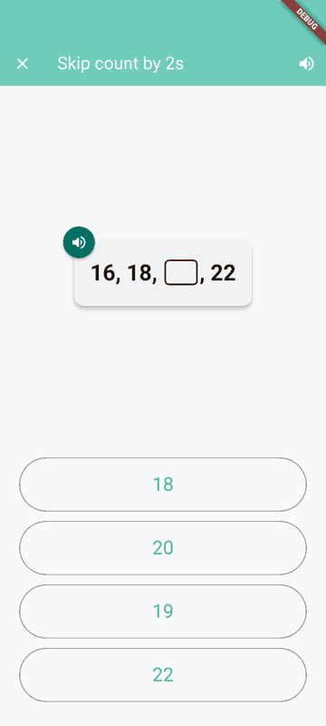 | 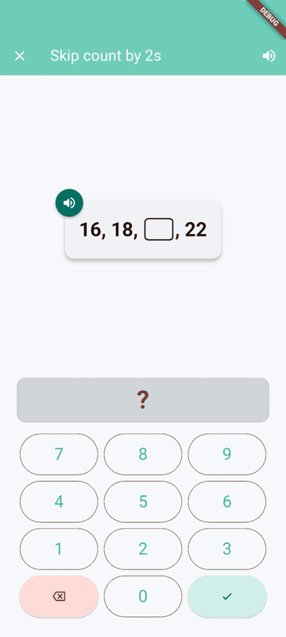 | 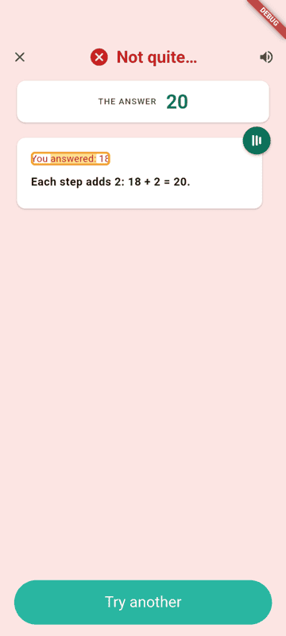 |  |

## 3.4 Multiplication & Division (`mult_div`)

| | Concept | Question (MC) | Question (keypad) | Wrong answer | Notes |
|---|---|---|---|---|---|
| ✅ | **Multiply in any order** `commutative_mult` G3 | 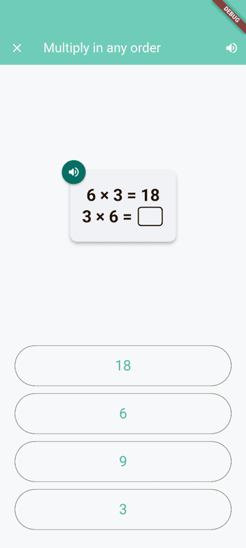 | 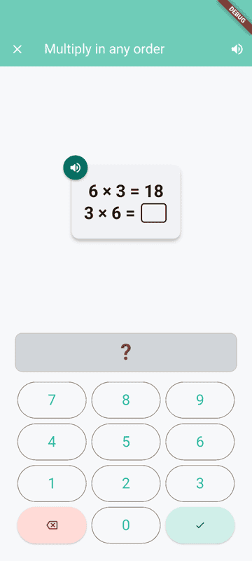 | 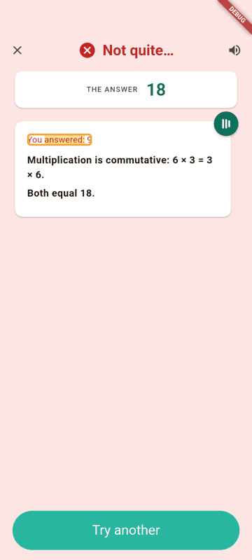 |  |
| ✅ | **Group factors any way** `associative_mult` G3 | 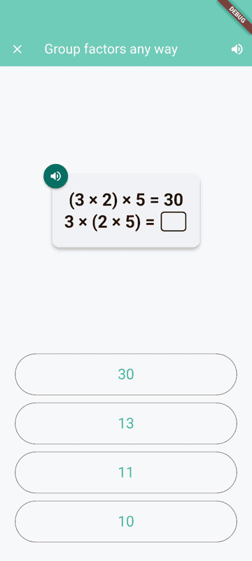 | 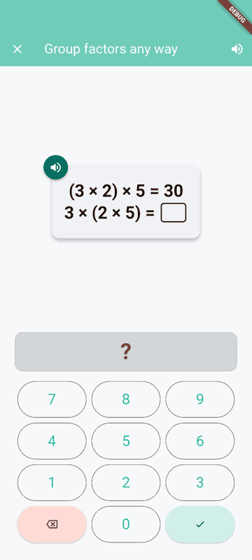 | 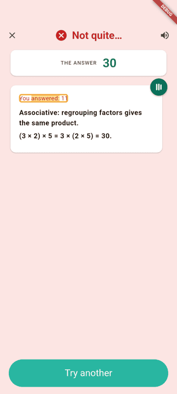 |  |

## 3.5 Fractions (`fractions`)

| | Concept | Question (MC) | Question (keypad) | Wrong answer | Notes |
|---|---|---|---|---|---|
| ✅ | **What is a/b?** `fraction_a_over_b` G3 · FractionBarSpec | 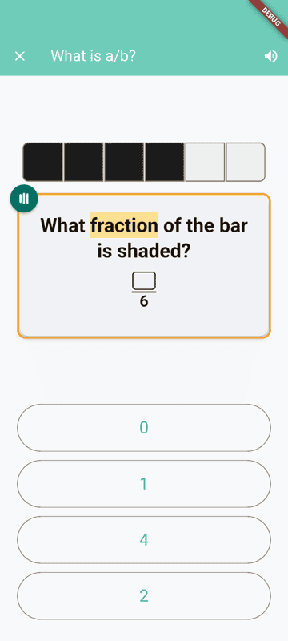 | 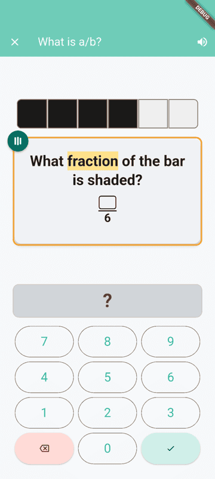 | 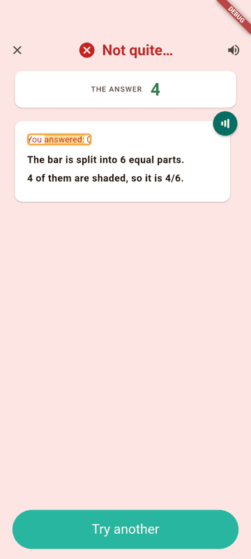 |  |
| ✅ | **Find equivalent fraction** `equivalent_fractions_compute` G4 | 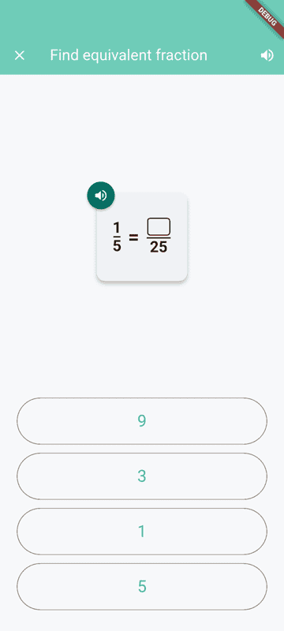 | 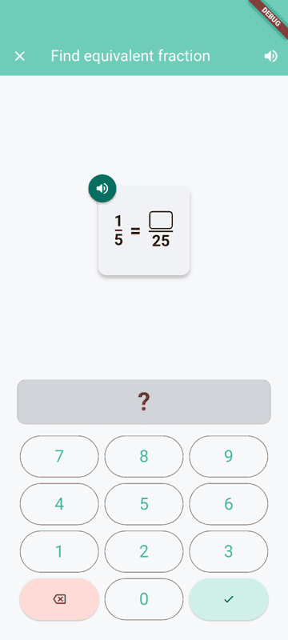 | 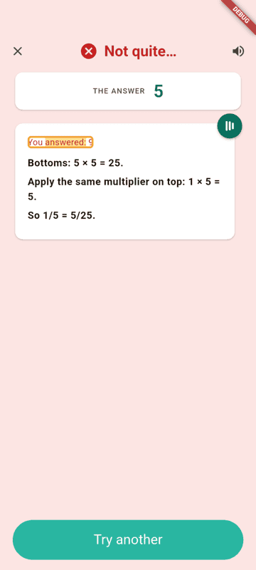 |  |

## 3.6 Decimals & Percentages (`decimals_percent`)

| | Concept | Question (MC) | Question (keypad) | Wrong answer | Notes |
|---|---|---|---|---|---|
| ✅ | **Tenths and hundredths** `fraction_denom_10_100` G4 · FractionBarSpec | 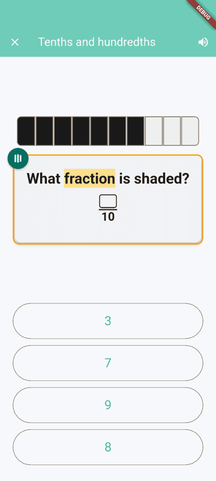 | 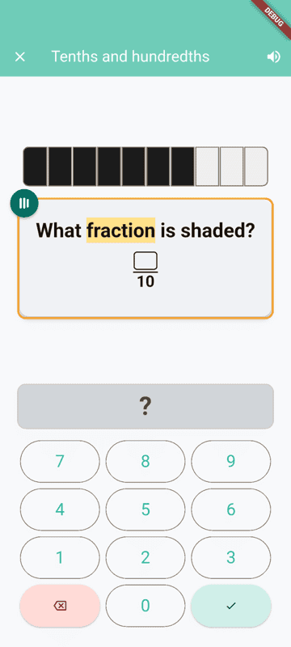 | 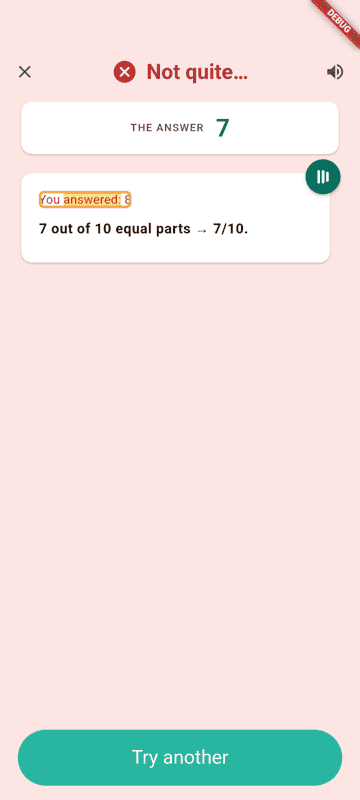 |  |

## 3.11 Pre-Algebra (`prealgebra`)

| | Concept | Question (MC) | Question (keypad) | Wrong answer | Notes |
|---|---|---|---|---|---|
| ✅ | **Find missing addend** `missing_addend_within_20` G1 | 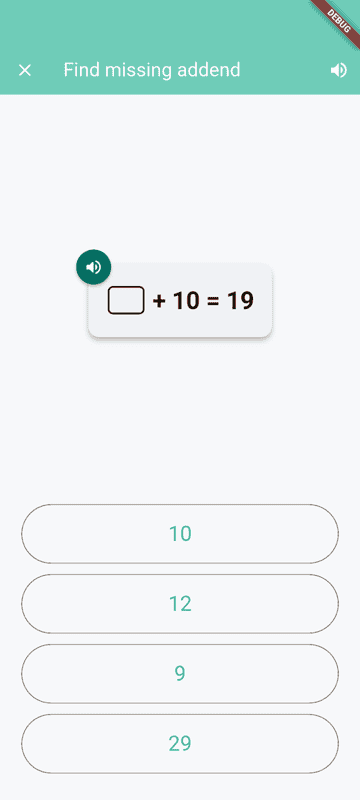 | 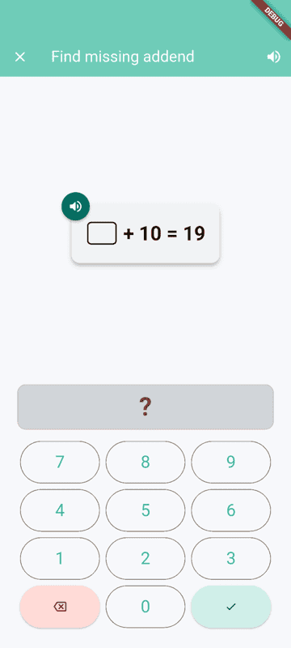 |  |  |

